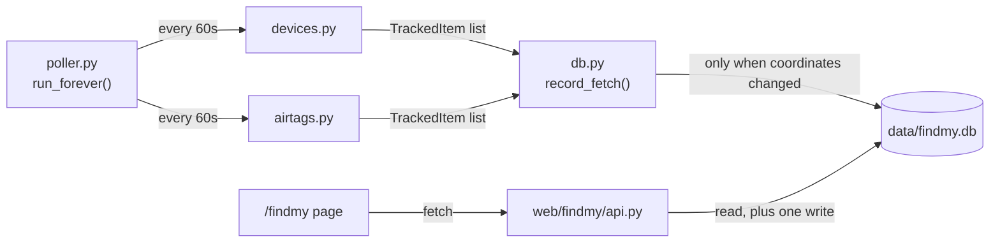
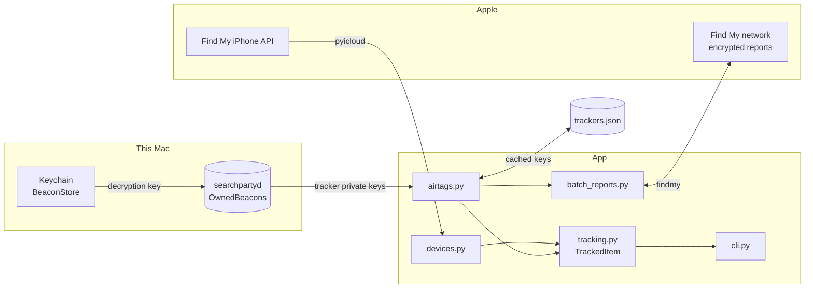

# Find My

Locations for your Apple devices and your AirTags, in one table or on one map, with the distance from
home next to each. One page of [my-cloud](../README.md); read that first for setup and the web shell.

Apple keeps these two kinds of thing in completely separate systems, so this has two backends behind one
data model.

| Source | Covers | How it works |
|--------|--------|--------------|
| `src/findmy/devices.py` | iPhones, iPads, Macs, AirPods | The classic Find My iPhone API. The device is online and reports where it is |
| `src/findmy/airtags.py` | AirTags, Sualio, ACCUTag, Smart Card | The crowdsourced network. The tracker has no radio of its own, so passing Apple devices relay an encrypted beacon on its behalf |

Both return `list[TrackedItem]`, which is why `mycloud all` can concatenate them and print one table.

## Commands

```bash
uv run mycloud devices          # iCloud devices
uv run mycloud airtags          # trackers
uv run mycloud all              # both
uv run mycloud refresh-keys     # re-read tracker keys, locate nothing
uv run mycloud serve            # web UI and API, with the poller
uv run mycloud poll             # just the poller, for multi-worker deploys
```

`--sort {name,distance,age}` defaults to distance. `--json` prints machine-readable output. Items with no
location always sort last, whichever sort you pick.

```bash
uv run mycloud all --sort age
uv run mycloud airtags --json | jq '.[] | select(.distance_m > 100)'
uv run mycloud airtags --refresh-keys    # after pairing something new
```

Rows are green when the fix is under an hour old, yellow when older, dim when there is no fix at all.

```
                                                       AirTags
┏━━━━━━━━━━━━━━━━━━━━┳━━━━━━━━━━━━━━━━━━━━━━━━━┳━━━━━━━━━━━━━━━━━━━━━━┳━━━━━━━━━━┳━━━━━━━━━━━━━┳━━━━━━━━━━━━━━━━━━━━━┓
┃ Name               ┃ Kind                    ┃ Location             ┃ Distance ┃         Age ┃ Last seen           ┃
┡━━━━━━━━━━━━━━━━━━━━╇━━━━━━━━━━━━━━━━━━━━━━━━━╇━━━━━━━━━━━━━━━━━━━━━━╇━━━━━━━━━━╇━━━━━━━━━━━━━╇━━━━━━━━━━━━━━━━━━━━━┩
│ Sunglasses         │ AirTag (2nd generation) │ 52.498943, 13.403543 │      5 m │   8 min ago │ 2026-08-12 11:39:20 │
│ e-bike             │ AirTag (2nd generation) │ 52.498889, 13.403489 │     11 m │ 300 min ago │ 2026-08-12 06:46:50 │
│ Spare keys outside │ Sualio Tag              │ 52.498073, 13.403728 │    103 m │  35 min ago │ 2026-08-12 11:11:50 │
│ Pink Bike          │ ACCUTag                 │ unavailable          │        - │           - │ -                   │
└────────────────────┴─────────────────────────┴──────────────────────┴──────────┴─────────────┴─────────────────────┘
                                                  11 items in 9.1s
```

## The page and its API

`GET /findmy` is a plain client-side page: ES modules, one stylesheet on top of the shell's, no build
step. A device list with show/hide checkboxes sits beside a [Leaflet](https://leafletjs.com/) map with a
time filter (1h, 6h, 24h, 7d, all) so months of poller history do not swamp it. Leaflet and the map tiles
come from CDNs, so the page needs internet access even though the data is local.

| Route | Returns |
|-------|---------|
| `GET /api/findmy/config` | Home coordinates to centre on, and whether Telegram is configured |
| `GET /api/findmy/status` | When the poller last finished a cycle |
| `GET /api/findmy/locations` | Latest fix for every device, with distance from home |
| `GET /api/findmy/locations/<id>` | Latest fix for one device, 404 if unknown |
| `GET /api/findmy/locations/<id>/history` | That device's fixes, newest first. `?since=<ISO8601>` and `?limit=<N>` narrow it |
| `PUT /api/findmy/locations/<id>/icon` | Set `{"emoji": "🚲"}` or clear `{"emoji": null}` the map marker |
| `GET /api/findmy/alerts` | Configured alerts |
| `POST /api/findmy/alerts` | Create one: `{"device_id", "alert_type": "movement"\|"enter"\|"exit", "threshold_m", "anchor": "home"\|"current"}` |
| `PUT /api/findmy/alerts/<id>` | Change an existing alert's type, threshold or anchor |

`id` is Apple's own identifier, so renaming something in the Find My app does not orphan its history. For
devices that is `device.data["id"]`; for trackers `accessory.identifier`, or a hash of the master key for
third-party tags where Apple leaves that field blank.

## How data gets there



Six tables, queried in `src/findmy/db.py`:

- `devices`, the latest name and kind per device.
- `location_history`, one row per fix. Written only when the coordinates differ from the last stored fix,
  so a stationary AirTag reporting the same position all day adds one row, not 1,440.
- `device_icons`, the marker emoji you pick in the dashboard. Apple does not expose the emoji from the
  Find My app to either library, so this is separate state.
- `alerts`, the definitions plus current `is_active` state.
- `alert_events`, one row per firing. Kept apart from `alerts` so configuration and history do not share
  a row and fight over it.
- `tracker_alignment`, where each tracker is in its key rotation. See [key caching](#key-caching).

Running more than one web worker means passing `--no-poll` and running `uv run mycloud poll` separately,
so exactly one process writes to the database. `install/` ships that as its own systemd unit.

## Alerts

Movement, enter and exit, evaluated by `src/findmy/alerts.py` from inside the poller rather than from a
request. Enter and exit are edge-triggered, so sitting inside a radius does not re-fire; all three are
cooldown-gated. Delivery is Telegram, via `src/findmy/telegram.py`.

Metrics, prefixed `my-cloud.{function}.*`:

| Stat | Where | Meaning |
|------|-------|---------|
| `_poll_once.duration` | `poller.py` | Whole cycle: both fetches plus the write |
| `run_forever.failure` / `consecutive_failures` | `poller.py` | Failure count and the live backoff streak |
| `check_alerts.movement_triggered` | `alerts.py` | Something moved past its threshold |
| `check_alerts.enter_triggered` / `exit_triggered` | `alerts.py` | Something crossed a radius boundary |
| `_notify.telegram_failed` | `alerts.py` | The alert fired but the push did not go out |

## Map tiles

The style picker offers free CARTO and OSM rasters with no configuration. Two keys add more.
`MAPTILER_API_KEY` goes to the browser and tiles are fetched directly. `GOOGLE_MAPS_API_KEY` cannot work
that way: every Google tile needs a server-minted session token and is billed per request, so
`src/maps/google_tiles.py` holds the token and `/api/tiles/google/...` proxies each image, keeping the
billable key server-side.

Tiles are cached to `data/google_tiles/` with joblib and pruned at 30 days on boot, so the cache survives
restarts and is shared across browsers. Responses also carry a 30-day `Cache-Control`, which lets a warm
browser skip the proxy entirely. Google's free tier is 100k tile requests a month, and a dashboard centred
on one neighbourhood converges on a few hundred distinct tiles, so in practice the cache is what keeps it
free. Compare `google_tiles_downloaded` against `google_tiles_served` for the hit rate.

Which styles exist is the server's decision. `GET /api/config` reports `google_map_types` and the page
renders whatever it is handed.

## Why two libraries

`pyicloud` cannot see AirTags at all. A tracker has no network connection, so its location exists only as
reports encrypted to its public key and relayed by strangers' iPhones. Decrypting one needs the tracker's
private key, which lives in `~/Library/com.apple.icloud.searchpartyd/OwnedBeacons/` on a Mac that paired
it. That is what the `findmy` library handles and `pyicloud` does not.

Worth knowing: the `pyicloud` on PyPI is the [timlaing fork](https://github.com/timlaing/pyicloud), which
is maintained. The original `picklepete/pyicloud` stopped getting commits in late 2024.



## Key caching

A tracker's keys are fixed when you pair it, so `src/findmy/airtags.py` caches them in
`.icloud_session/trackers.json` at mode 400 and only reads the Keychain on a first run or with
`--refresh-keys`. Every other path treats that file as read-only. The refresh writes to a temp file and
renames, so an interrupted write cannot leave half a file where your master keys were.

Rolling-key *alignment* is different: it moves every time you locate something, so it lives in the
`tracker_alignment` table. Without it an accessory falls back to its pairing date and rescans weeks of
keys on every lookup. It is only ever a cache. A missing row falls back to `trackers.json`, and a database
error is logged and skipped rather than failing the lookup, because `mycloud airtags` locates fine without
opening a database at all.

**The trade-off is real.** This writes tracker master keys to disk in plaintext. Anyone who gets that file
can locate those trackers forever, and a master key is fixed at pairing so it cannot be rotated afterwards.
It sits inside the git-ignored session directory at mode 400, and deleting it falls back to the Keychain.
It is deliberately kept out of `data/findmy.db`, which the R2 and git backup jobs sweep up: git history is
append-only, so a key committed once is committed permanently.

### Moving to another Mac

Keys belong to the pairing, not to the machine, so copying the whole `.icloud_session/` directory works:

```bash
scp -r .icloud_session/ new-mac:/path/to/my-cloud/.icloud_session/
chmod 600 .icloud_session/trackers.json   # scp does not always preserve the mode
uv run mycloud airtags
```

Copy all of it: `trackers.json`, `findmy_account.json`, `ani_libs.bin`, and the pyicloud cookiejar. A Mac
that never paired these trackers has no `OwnedBeacons/` record for them, so `--refresh-keys` there comes
back empty and cannot recover what you did not bring.

If the account session gets rejected and asks for 2FA, delete only `findmy_account.json` and
`ani_libs.bin`, then re-authenticate. Keep `trackers.json`. The new Mac cannot regenerate it.

## Batched report fetching

The `findmy` library's own `fetch_location()` asks about one accessory at a time and walks its rolling
keys backwards until it finds a report, costing an HTTP request and an Anisette header generation per 290
keys. `src/findmy/batch_reports.py` exploits something the public API does not expose: Apple's reports
endpoint takes a *list* of key groups per request, and the 290-key cap applies per group rather than per
request. So it probes everyone's newest keys in one cheap round, then makes one batched sweep for whoever
stayed quiet. On 11 trackers that took roughly 27 requests down to 3, and 14.1s down to 9.1s.

Getting there means reaching into `fetch_raw_reports`, `LocationReport.decrypt` and
`FindMyAccessory.update_alignment`, none of which are public. That is why `findmy` is pinned to an exact
version and why `tests/test_batch_reports.py` checks the chunking and attribution against stubs.

Concurrency does not help. Every request needs fresh Anisette headers from an emulated ARM library that is
effectively single-threaded, so parallel lookups get slower rather than faster. Of the remaining 9.1s,
about 5.4s is rolling-key derivation on the CPU, not waiting on the network.

## Why memory saw-tooths

Expect the service to gain a few MB an hour and then drop back, over and over. The saw-tooth is on
purpose. The growth underneath it is not, and it is not a leak in this code: the Python heap is flat.

Every Anisette header re-enters the emulated ARM library and appends 40 to 50 kB to Unicorn's JIT
translation buffer, which QEMU only reclaims when its 1 GiB region flushes. One header goes out per request
to Apple, so a process holding one VM open grows about 69 MB a day, unbounded. The `anisette` package ships
a mitigation that restarts the VM once a guest allocator passes 50% utilisation, but under this workload
that allocator sits near 0.1%, so it never fires.

`_get_anisette_provider` in `src/findmy/airtags.py` therefore recycles the VM every `_ANISETTE_MAX_USES`
generations, which caps the buffer around 10 MB. Two details in that function carry the whole fix: the VM
is released explicitly instead of being left to the garbage collector, and the cyclic collector is invoked
by hand. Drop either one and discarded VMs pile up, leaving memory use worse than doing nothing.

Since the fix depends on another package's internals, `install/projects_my-cloud.service` also sets
`MemoryMax=300M` with `Restart=always` as a backstop. If an upstream change ever breaks the recycling, the
failure mode is accumulating VMs rather than a crash, and the ceiling converts that into a restart instead
of a slow climb up the host's RAM. Hitting that limit is a signal to look at the recycling, not to raise
the limit.

The same emulation is why this burns roughly 12% of a core continuously despite polling once a minute.
Both costs scale directly with `POLL_INTERVAL_SECONDS` in `src/findmy/poller.py`, which makes the interval
the cheapest lever on either one.

## Sessions

`serve` cannot handle the one-time 2FA or Keychain prompt. Run `uv run mycloud airtags` or `mycloud devices`
at a console first, or the dashboard comes up empty until that cache exists.

If the session expires later, the poller logs a warning each cycle and backs off up to 15 minutes rather
than hammering Apple. Re-run the same console command to refresh it.

## What is tested

`src/core/config.py`, the pure functions in `tracking.py` (distance, age, sorting), the chunking and
attribution in `batch_reports.py` against stubs, `db.py`'s change detection against a temp SQLite file, and
every route through Flask's test client with `create_app(start_poller=False)`.

Not covered: `fetch_devices`, `fetch_airtags`, and the poller. They need a live Apple session, and mocking
them would only test the mock.
